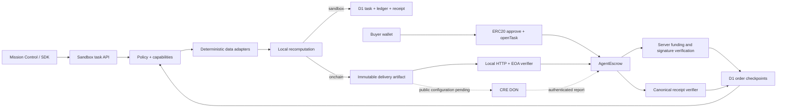

# AgentOS MVP 架构

## 产品范围

| 模块 | 当前实现 | 后续工作 |
| --- | --- | --- |
| Identity | 本地 profile；ERC-8004 注册 document/calldata adapter | 测试网 register、解析 tokenURI、身份与支付地址绑定 |
| Wallet | 模拟余额；AgentVault 合约；网页 EIP-1193/本地钱包与链上余额 | 真实浏览器扩展与公共测试网验收 |
| Memory | 按智能体/内容/哈希检索任务输入、结果、事件、收据；上下文导出 | 租户级私有向量知识库 |
| Skills | 两个确定性适配器，内置/自定义数据、版本、capability 清单 | MCP/A2A 适配、隔离外部执行进程 |
| Reputation | 基于当前 workspace 的完成任务计数 | 验证过的反馈源、ERC-8004 Reputation Registry |
| Payments | 模拟账本、单链 ERC-20 托管、回执核验与 UI 同步；买方签名绑定工作区、服务端复核、D1 幂等历史 | 公共测试网、持续重组监控与 x402 采购 |
| Permissions | 服务端 typed operation gate；预算；实时撤销 | 签名 session grant、目标合约与 selector 授权 |
| Escrow | 原子预留/结算/退款；真实托管回执、输入预承诺、先注资后后台执行、失败链上退款 | 公共网络验收与持续重组监控 |
| Marketplace | 可注册/启停本地服务的目录、固定报价与任务分配 | 外部供应商发现、真实服务 SLA |
| Execution | 服务端后台执行、持久化状态机、幂等请求、有限退避重试、恢复 API、本地 worker 与任务期限 | 独立持久队列、外部执行租约 |

## 两条执行路径

两条支付模式均已接通网页。预注资订单通过 `demo:prefund` 验证先确认真实托管、再执行并结算的链路；既有成果还可通过 `demo:chain`/`demo:reconcile` 接入独立托管并保存回执。资金账本分别记录。AgentVault 合约当前独立测试，网页预注资入口由买方直接调用 AgentEscrow。CRE CLI 已通过本地 RPC 与真实 HTTPS 的 dry-run；DON/公共测试网尚未联调。

## 并发与恢复

每个用户持有一份 workspace aggregate，`revision` 是 CAS 版本。任务、预留金额、付款记录、收据在一个 D1 UPDATE 中写入；版本冲突最多重新计算 12 次。CAS 防止两个并发请求对同一旧余额分别成功扣款。达到重试上限返回 409，调用方用同一 requestId 重试。

`advance` 携带 expectedStep。过期请求保持原状态；任务结算与 receipt 同时持久化。故障演示在已提交付款后转入 paused，resume 只补最后一步。此保证限于当前 D1 aggregate；外部真实转账需以链上 taskId、最终回执及 reconciliation 实现同等保证。

余额：`available = deposits − settled − active reservations`。服务费使用创建时固定报价；多余预算释放。日预算按 UTC 结算额加全部在途预留进行保守核算。

## 信任边界

- 模型/外部工具不能直接转账；当前数据适配器只允许 dataset.read 与 artifact.write。未来接入模型时仍必须把输出解析为有限 typed operations；不能把字符串当脚本运行。
- 演示攻击是一个确定性恶意 tool-operation 测试用例，并不意味着已经评测真实模型对 prompt injection 的普遍抵抗能力。
- 本地 SHA-256 收据验证数据完整性，不提供签发方真实性：任何人都可以修改内容再重算 hash。真实凭证需要签名或链上事件。
- D1 由服务运营者管理。当前操作日志不是防运营者篡改的审计链。
- 托管站依赖可信身份网关注入 `oai-authenticated-user-id`。部署到其他基础设施前必须移除此信任假设并实现自己的鉴权。禁止把回环匿名模式直接暴露公网。
- EVM 合约只支持可信、标准返回值、无手续费、非 rebasing ERC-20。合约未经独立审计。测试代币不代表生产代币行为。
- CRE 确保指定工作流执行及报告认证，不保证数据源本身真实。当前校验的是买方事先固定的数据字节与简单算术结果，不能验证任意研究报告质量。
- 钱包权限撤销影响后续开单；已经 funded 的 escrow 仍按原交付规则结算或超时退款。退款不补回当日 vault allowance，避免循环重置限额。

## 规模限制

原型单用户最多 300 个任务；整体 JSON aggregate 适合演示和小规模使用。正式版需按 task/account/ledger 拆表，使用可靠队列驱动，加入请求速率、账本体积与存储留存限制。当前没有跨链、通用插件沙箱、生产 session key、LLM 推理、真正自治调度。
