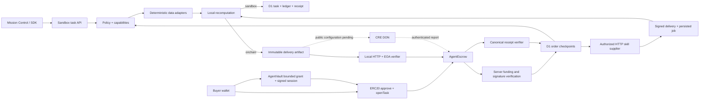

# AgentOS MVP 架构

## 产品范围

| 模块 | 当前实现 | 后续工作 |
| --- | --- | --- |
| Identity | 官方 ERC-8004 本地注册、链上 data URI 校验、持有者签名与支付钱包绑定、订单身份快照 | 公共测试网与真实浏览器扩展验收 |
| Wallet | 模拟余额；AgentVault 合约；网页 EIP-1193/本地钱包与链上余额 | 真实浏览器扩展与公共测试网验收 |
| Memory | 关键词及真实多语言向量检索、私有笔记、已付款成果审阅采用、可信输入引用与多父汇合 | 大规模向量服务及更多规划场景的受控自动采用 |
| Skills | 版本化技能、独立签名供应商、QuickJS 通用 JSON 插件与只读 MCP；统一服务描述、插件目标规划；独立复算或签名重放验收 | 通用插件模板/修复统一、开放发现 |
| Reputation | 官方信誉表交易、原买方付款证明核验、独立订单去重评分、撤销与对账 | 公共网络、持续重组监控与全网索引 |
| Payments | 独立模拟账本、单链 ERC-20 托管、Vault 连续采购、通用插件本地付费、回执核验及 D1 幂等历史 | 公共测试网、通用插件公共结算、持续重组监控与 x402 |
| Permissions | 预算与撤销、Vault 签名会话、插件代码/运行时/单价绑定、链上执行者金额与收款限制 | 合约独立验证完整会话及插件权限、公共网络验收 |
| Escrow | 原子预留/结算/退款；真实托管回执、输入预承诺、先注资后后台执行、失败链上退款 | 公共网络验收与持续重组监控 |
| Marketplace | 配置供应商目录、签名报价比较、链上委托与独立收款、退款确认后在审阅范围内改购 | 开放注册/发现、信誉路由及真实服务 SLA |
| Execution | D1 持久队列及租约、幂等恢复、期限、受限多步/并行工作流、条件跳过、多父汇合、目标规划、模板与受限自动修复提案 | 循环/子工作流、生产队列运维与外部执行 SLA |

## 两条执行路径

两条支付模式均已接通网页。预注资订单通过 `demo:prefund` 验证先确认真实托管、再执行并结算的链路；既有成果还可通过 `demo:chain`/`demo:reconcile` 接入独立托管并保存回执。资金账本分别记录。AgentVault 订单可通过已签名会话自动注资，保留人类买方与 Vault 实际付款方的区别；会话与每日额度、撤销、退款和恢复边界见 VAULT.md，当前验收状态见 ROADMAP-IMPLEMENTATION.md。CRE CLI 已通过本地 RPC 与真实 HTTPS 的 dry-run；DON/公共测试网尚未联调。

## 并发与恢复

每个用户持有一份 workspace aggregate，`revision` 是 CAS 版本。任务、预留金额、付款记录、收据与队列写入通过 D1 原子 batch 提交；版本冲突最多重新计算 12 次。CAS 防止两个并发请求对同一旧余额分别成功扣款。达到重试上限返回 409，调用方用同一 requestId 重试。

`advance` 携带 expectedStep。过期请求保持原状态；任务结算与 receipt 同时持久化。故障演示在已提交付款后转入 paused，resume 只补最后一步。此保证限于当前 D1 aggregate；外部真实转账需以链上 taskId、最终回执及 reconciliation 实现同等保证。

余额：`available = deposits − settled − active reservations`。服务费使用创建时固定报价；多余预算释放。日预算按 UTC 结算额加全部在途预留进行保守核算。

## 信任边界

- 模型/外部工具不能直接转账；当前数据适配器只允许 dataset.read 与 artifact.write。模型输出解析为有限 typed operations；不能把字符串当脚本运行。
- 演示攻击是一个确定性恶意 tool-operation 测试用例，并不意味着已经评测真实模型对 prompt injection 的普遍抵抗能力。
- 本地 SHA-256 收据验证数据完整性，不提供签发方真实性：任何人都可以修改内容再重算 hash。真实凭证需要签名或链上事件。
- D1 由服务运营者管理。当前操作日志不是防运营者篡改的审计链。
- 托管站依赖可信身份网关注入 `oai-authenticated-user-id`。部署到其他基础设施前必须移除此信任假设并实现自己的鉴权。禁止把回环匿名模式直接暴露公网。
- EVM 合约只支持可信、标准返回值、无手续费、非 rebasing ERC-20。合约未经独立审计。测试代币不代表生产代币行为。
- CRE 确保指定工作流执行及报告认证，不保证数据源本身真实。当前校验的是买方事先固定的数据字节与简单算术结果，不能验证任意研究报告质量。
- 钱包权限撤销影响后续开单；已经 funded 的 escrow 仍按原交付规则结算或超时退款。退款不补回当日 vault allowance，避免循环重置限额。

## 规模限制

原型单用户最多 300 个任务；整体 JSON aggregate 适合演示和小规模使用。正式版需按 task/account/ledger 拆表，扩展现有 D1 队列的监控和吞吐，加入请求速率、账本体积与存储留存限制。预注资订单支持可选真实 LLM 工具规划，推理在独立服务运行；模型输出经能力检查后调用现有确定性适配器。模型的配置哈希、计划与推理证据随订单保存，详见 MODEL.md。当前已有受限 QuickJS 插件沙箱及只读 MCP，通用 JSON 付费流程由独立本地重放验收；详见 PLUGINS.md 与 PLUGIN-PURCHASES.md。跨链、生产 session key、通用插件公网结算和生产级队列运维保障仍待完成。

业务工作流独立于六阶段订单生命周期：顺序程序支持 2–8 步，审阅式修复可含一步；并行模式显式限制 2–4 个在途采购并核验所有依赖父成果后汇合。旧两步协议保留原语义。工作流有独立持久队列任务，覆盖步骤之间的崩溃窗口；并行图由同一个带租约的作业调度，已注资子订单仍有结算和退款义务。详见 WORKFLOWS.md、WORKFLOW-PLANNING.md、AUTOMATIC-REPAIR.md 与 PARALLEL-WORKFLOWS.md。
