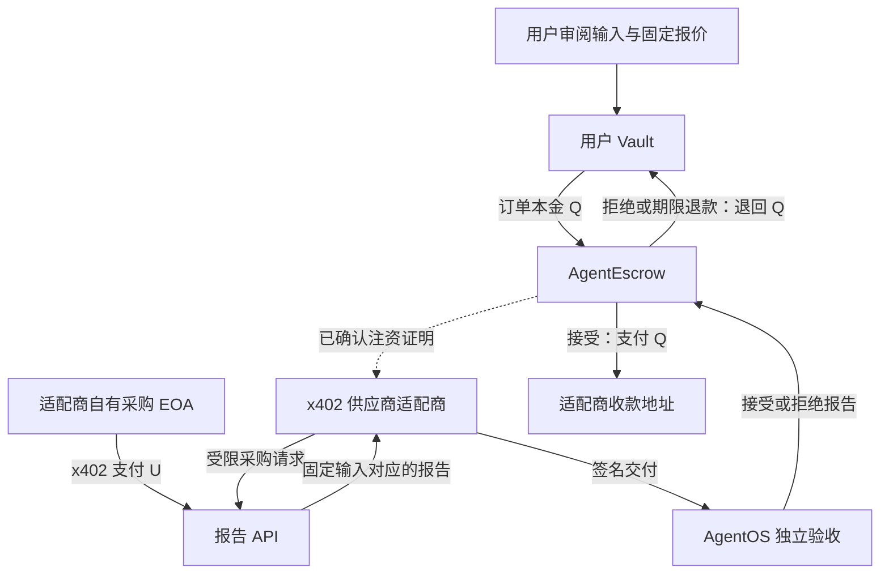

# x402 接入设计：可验收的 USDC 财库支出报告采购

状态：历史设计提案。x402 已完成本地实现；当前实现与验收见 [实现记录](X402-IMPLEMENTATION.md)、[恢复与 Feed 验收](P1_P2_LOCAL_ACCEPTANCE_2026-10-23.md) 和 [全历史回归](FULL_HISTORY_ACCEPTANCE_2026-10-23.md)。以下保留原设计，不代表当前待办。

设计日期：2026-10-23（Asia/Hong_Kong）。代码基线：`77fa139`。本方案保留当前本地优先的交付范围，公网、DON 和托管运维另设验收门槛。

## 1. 决策

首个场景选择“按次采购 USDC 财库支出分配报告”。AgentOS 导入一个地址在最终确认区间中的 USDC 转账，用户审阅固定价格并授权 Vault；一个身份绑定的供应商适配商通过 x402 购买报告，AgentOS 独立复算后决定支付或退回托管资金。

推荐接入方式为 **Vault 托管用户订单 + 适配商自有钱包采购上游 x402 服务**。用户购买的是带验收和退款条件的完整报告服务。适配商承担上游采购、短期垫资和上游失败成本。

第一版使用独立运行的参考 x402 报告服务，实际执行官方协议和本地 EVM 代币交易；它是可复现的接入样例，不宣称已经接入独立商业数据商。

### 为什么选择这个场景

- 可复用现有 `treasury-report`、转账来源验证、签名供应商、Vault 和完整成果校验。
- 输入在付款前已经固定，避免“必须先购买数据才能承诺输入”的协议改造。
- 报告包含完整收款方分配，能独立复算；错误明细即使重算哈希也应拒收。
- 可接到已有集中度插件或后续管理报告；首期先验收单份报告，后续插件作为独立采购计价。
- 不把不可独立证明的地址标签、任意研究结论或自然语言质量作为首个付款依据。

## 2. 协议事实与已有代码限制

官方 x402 `exact` EVM 方案支持 EIP-3009、Permit2 等资产转移方式。这里固定 x402 v2、`exact`、EIP-3009、一个明确配置的六位小数代币和普通 EOA 采购钱包，减少首轮兼容面。不是断言 x402 只能支持这种钱包。

`exact` 已执行的支付是推送付款。上游退款需要商家另行转账，不能依赖 HTTP 失败、服务端拒收或 AgentOS 退款自动撤回该付款。

现有代码存在两个直接接入障碍：

1. `contracts/AgentVault.sol` 的执行入口仅能对固定 `AgentEscrow` 开单；没有通用转账、EIP-1271 验签或 ERC-7710 委托接口。不能让 executor 的 EOA 签名冒充 Vault 的付款授权。
2. `contracts/test/MockToken.sol` 只有基础 ERC-20 行为，没有 EIP-3009。完整本地演示需要新建专用测试代币，不应声称旧 MockToken 原样就支持 x402。

首期复用现有 Vault/Escrow 合约，新增适配商和测试设施。若将来要求“上游 x402 直接扣用户 Vault”，需要单独设计合约钱包权限、签名兼容和付款失败风险政策，不能通过放开当前 Vault 的任意调用权限替代。

官方依据：

- [x402 exact EVM 规范](https://github.com/x402-foundation/x402/blob/main/specs/schemes/exact/scheme_exact_evm.md)
- [钱包兼容性](https://docs.x402.org/advanced-concepts/wallet-compatibility)
- [退款说明](https://docs.x402.org/faq)

## 3. 参与方与资金流

| 参与方 | 职责 | 资金权限 |
| --- | --- | --- |
| 用户 / AgentOS | 审阅输入、供应商、价格和会话；独立验证成果 | 现有 owner 权限与 Vault 会话 |
| 用户 Vault | 为已批准订单提供托管本金 | 固定 escrow、单笔、UTC 日额度、收款白名单 |
| AgentEscrow | 保存用户订单资金；接受有效报告或期限退款 | 沿用现有验证与结算规则 |
| x402 供应商适配商 | 实现现有签名报价/执行协议；采购上游报告 | 自有小额采购 EOA，与 Vault executor 和用户密钥分开 |
| x402 报告 API | 按固定输入生成确定性报告 | 收取适配商支付的费用 |
| Facilitator | 校验授权并广播代币转移 | 独立测试 gas 账户，无用户或采购钱包私钥 |



用户订单收款人是适配商的身份钱包。上游 API 收款人仅出现在适配商采购政策中，不需要加入用户 Vault 的收款白名单。适配商收款钱包和采购 EOA 可以分开，证据应明确它们各自的角色。

## 4. 用户看到的业务流程

1. 选择财库地址和最终确认区间，导入最多 25 条来源完整的 USDC 转账。空样本不创建本次付费报告订单。
2. 选择“x402 财库报告供应商”，查看输入摘要、原始六位精度金额、报告范围、固定服务报价、上游最大采购价、执行期限和退款条件。
3. 明确允许将这份输入发送给适配商和指定上游报告 API。非公开自定义转账需要同样的披露；首期 UI 默认只接受已经审阅的公开链样本。
4. 选择已有 Vault 会话；会话需要允许 `treasury-report` 和适配商收款方。没有兼容会话时正常创建新授权。
5. 创建现有预注资供应商订单，D1 原子预留额度并由现有 worker 注资。
6. 注资回执确认后，运行时为当前供应商执行租约签发短期采购票据；适配商检查票据和当前权限后才执行带输入的上游请求。价格发现/策略读取不发送原始转账。
7. 在订单详情中分别显示“上游支付”“成果验收”“用户订单结算”，三者有各自状态和凭证。
8. 成功后可将已付款报告作为现有集中度插件的输入。新增插件订单需单独显示价格、预留额度与授权，不能隐藏在本份报告价格之外扣款。

首期不用模型决定任意付款地址。后续 AI 规划只能选择已经安装、已经批准且描述已固定的适配商服务。

## 5. 两本资金账与预算控制

以下均为设计演示价格，币种为同一隔离本地链上的 `DemoUSDC`，不是市场报价或现有供应商价格：

- 用户固定服务报价 Q = 1.00，现有整数分表示为 `100`。
- 上游单次最大价格 Umax = 0.20，最小单位表示为 `"200000"`。
- 实际上游价 U = 0.20 时，成功订单适配商收入 1.00、上游成本 0.20，代币毛差额 0.80；该差额尚未扣 gas、运维或税费。
- 用户预算预留为 Q，不额外再扣一次 U。U 是适配商履约成本。

### 用户账

沿用现有签名报价、工作区每日预算、Vault 会话总额、链上单笔/每日额度、收款白名单和未来步骤预留。不能只检查链上 grant 而跳过应用层会话。

注资前取消且确认未发送的订单可以释放预留；已经 funded 的失败订单退回 Vault，但仍消耗原会话的累计尝试额度和链上当日已用额度，保持现有保守核算。只有实际链上回执完成核验，UI 才显示已退款。

### 适配商采购账

新增跨工作区共享的采购预算账，按 `(network, asset, payerWallet, UTC day)` 计数并使用钱包级共享事务锁，防止多个工作区同时花同一钱包预算。跨日仍可执行或尚未确认的历史授权也计入当前可用上限，不能在午夜因换预算桶而消失；实际结算按规范区块时间记入当日。

```text
已结算采购成本 + 未确认授权敞口 + 本次新预留 <= 采购日上限
本次 402 amount <= 订单冻结的 Umax
本次 402 的 network / asset / payTo / URL / scheme / 转移方式 全部匹配政策
```

金额使用十进制字符串与 BigInt，不能通过浮点数换算。六位精度下，现有整数分报价 Q 换算为 `Q * 10000` 最小单位。

首期每个用户订单最多 **1 个新付费授权**。HTTP 重试最多三次，复用同一 paymentId、nonce 和完整授权字节；这些重试不增加新的收费尝试。新报价、新收款方或新授权不能在重试中自动采用。

采购 EOA 自有资金不足时，该服务不可采购；不得从用户 Vault 补充资金。上游不确定支付仍占用采购额度。gas 使用独立的 gas 数量、单价和日上限；没有价格换算时，不宣称用户服务费上限覆盖全部运营成本。

本期采购政策由可信适配商执行，另以采购钱包小额余额限制敞口；不宣称这些新采购限制已经由当前 Vault 合约执行。

## 6. 采购政策、报价与 HTTP 接口

新增 `agentos.x402-supplier-policy.v1`，至少包含：

```text
providerId, upstreamOrigin, exactPath, method
network, token, tokenDecimals, eip712DomainName, eip712DomainVersion
scheme=exact, assetTransferMethod=eip3009
payTo, facilitatorOrigin, providerSigningAddress
maxAmountBaseUnits, maxNewAuthorizations=1, maxTransportRetries=3
authorizationTTLSeconds<=60, responseByteLimit, policyVersion
inputDisclosure, refundLiability=broker, resultProtocol
```

政策摘要与现有供应商描述绑定。首期可使用 `revision = "x402-v1-" + policyHashWithout0x`，该字段已进入现有 `configHash`，后者又进入签名报价及身份委托。UI 从适配商读取政策，严格解析并验证其摘要等于 revision 固定的值；不能仅展示一份未绑定的政策文字。策略更新需要新 revision、新委托和重新审阅，旧订单保留原政策。

建议接口：

| 位置 | 接口 | 语义 |
| --- | --- | --- |
| 适配商 | `POST /v1/quote` | 沿用签名供应商报价；冻结 Q、输入哈希和 configHash |
| 适配商 | `POST /v1/execute` | 沿用已注资供应商请求；相同 job 返回原交付 |
| 适配商 | `GET /v1/x402-policy` | 返回政策；调用方验证固定摘要 |
| 上游 API | `POST /v1/treasury-report` | 无支付时返回真实 402；有合法支付时返回固定结果 |
| 上游 API | 受认证的订单恢复入口 | 返回原 paymentId 的结果和结算状态，不再收费 |
| AgentOS | `POST /api/runtime/x402-authorize` | 短期票据限定的当前权限检查，不提供 owner 工作区访问 |
| AgentOS | owner 隔离的 x402 evidence 读取接口 | 返回脱敏采购证据，与订单详情关联 |

402 响应采用官方 v2 `PAYMENT-REQUIRED`；签名请求采用 `PAYMENT-SIGNATURE`；结算信息采用 `PAYMENT-RESPONSE`。采用官方 `payment-identifier` 扩展，且仍自行实现持久去重与链上对账。缓存键必须绑定付款方、资源路径、请求体哈希和 paymentId；ID 本身不是读取任意结果的凭证。

不会把通用自动付费 fetch 暴露给模型或插件。调用方不能传入新 URL、facilitator、token 或 payTo；固定 HTTPS 端点拒绝重定向，本地 HTTP 只在明确的隔离开发配置中允许。

现有供应商请求本身不能证明“应用层此刻仍允许执行”，因此需要新增短期采购票据。AgentOS 在领取供应商租约后生成随机票据，只存摘要，以服务间 header 发给固定适配商；不改变现有严格请求体，也不导出原始内部租约 token。票据绑定工作区、订单、供应商 job/configHash、policyHash、输入、Vault 会话/epoch 和租约期限。回调只核验指定采购意图，检查当前会话、权限、身份、取消状态和资金状态，不接受 caller 指定 owner 或任意任务。回调在一个原子事务内固定该采购的唯一 nonce/意图摘要；不同 nonce 的重放被拒绝。新签名前必须成功回调，票据失效或回调不可用时不签新授权；历史付款和原成果的只读对账仍可继续。签名发出后撤权不能保证阻止已授权上游付款，此时费用仍由适配商承担。

官方依据：[Payment-Identifier 扩展](https://docs.x402.org/extensions/payment-identifier)、[Facilitator](https://docs.x402.org/core-concepts/facilitator)。

## 7. 持久状态与崩溃恢复

保留现有用户订单状态机，新增适配商内部采购状态，不把“上游已付款”映射为“用户订单已付款”。

```text
created -> funding_verified -> challenge_validated -> cost_reserved
-> authorization_persisted -> submitted
-> payment_confirmed + result_received -> result_checked -> delivery_persisted

submitted -> payment_unknown -> reconcile -> payment_confirmed / proven_unpaid
任何业务终止 -> upstream_no_new_spend；已有支付独立继续对账
```

`payment_confirmed` 与 `result_received` 是两项独立事实，可以按不同顺序到达；只有二者和校验都满足，才发布正式供应商交付。

关键顺序：

1. 取得稳定 job 租约并固定规范请求哈希。复核用户订单资金、身份委托、短期票据、工作区权限和期限。
2. 收到 402 后逐项检查政策，原子预留适配商采购成本。
3. 官方 SDK 生成待签名 typed data 时，通过受限 signer 检查实际 domain、from/to/value、nonce 和时间窗；先持久化 paymentId、nonce 和未签名意图，再用票据确认该唯一意图仍获准。生成授权后，将完整签名字节和授权时间窗提交至私有持久存储，再发出网络请求。崩溃后只继续该意图，不换 nonce；不得假设重新调用 SDK 会自动复用原 nonce。
4. 签名发出后即视为存在资金风险；超时、取消 HTTP 或丢响应都不能释放授权敞口。
5. 恢复时使用原 payload 和 nonce。通过受信 RPC 核验交易、授权使用状态、对应 Transfer 的 from/to/value、token、网络和规范区块；不能仅信任上游返回 success。
6. 只有链上确认已付款才能将保留敞口转成已花费。授权已失效且规范链证明未使用后，才能按政策释放未花费的敞口；无法证明时继续保留并显示待对账。
7. 上游在结算前持久保存准备返回的结果与请求绑定；结算后崩溃仍能恢复原结果。适配商在返回签名交付前也先保存原交付。

建议采购键为 `hash(chainId, escrow, taskId, supplierConfigHash, attemptIndex)`；另对 `(network, token, payer, authorizationNonce)` 设置唯一约束。预算扣减与采购记录共用 SQLite 事务。数据库恢复、旧 lease 和并发驱动不能创建第二份有效授权。首期适配商与 facilitator 各自只允许一个持久发送队列，避免将未设计的多实例 nonce 竞争带入验收。

原始支付授权、签名和钱包密钥留在适配商私有存储，不进入公共成果、前端状态或 owner 导出；只导出必要摘要和已确认交易信息。付款签名与交付签名使用不同角色的密钥。

## 8. 交付验收与证据

验收包含四层，不互相替代：

| 层次 | 检查 |
| --- | --- |
| 来源 | 输入冻结；原始 USDC 六位精度、最终确认检查点、完整日志与来源哈希按现有机制复核 |
| 上游付款 | 验证 x402 授权与真实代币转移，只证明适配商采购付款 |
| 上游与适配商交付 | 上游签名绑定请求/输入哈希及完整输出；适配商再生成现有 `agentos.skill-delivery.v1` |
| 用户结算 | AgentOS 与现有独立验证器复算完整结果；规范成果通过后才允许用户 escrow 向适配商付款 |

沿用当前 `treasury-report` 输出协议，不向严格 output schema 塞入额外 x402 字段。报告保留当前整数分投影及完整来源摘要的规则；UI 区分 USDC 原始精度和报告投影，不把投影结果升级成新的精度承诺。集中度判断若继续执行，沿用现有基于原始六位精度的业务插件。

新增签名旁证 `agentos.x402-procurement-evidence.v1`，包含 orderId、taskId、scope、supplierJobId、supplierConfigHash、policyHash、inputHash、原供应商交付摘要、上游请求/响应摘要、paymentId、nonce 摘要、网络、token、付款/收款方、金额、交易哈希、规范区块、付款状态、验收状态和时间。旁证与原交付摘要做不可改写绑定，写入 owner 隔离的侧表。

首期旁证是独立签名审计材料；现有链上 `specHash` 和成果 envelope 没有自动承诺其全部字段。不得宣称现有 CRE 已独立证明 x402 采购、旁证或适配商利润。若要把采购过程也纳入链上验收，后续另升协议版本。

适配商不得在付费 API 失败后悄悄调用本地实现并报采购成功。用于验收的独立复算可以本地运行；正式交付的输出摘要必须对应实际获得的上游响应。

## 9. 退款、取消和不确定付款

| 情况 | 用户订单 | 上游采购 | 成本承担 |
| --- | --- | --- | --- |
| 审批前/注资前预算拒绝 | 不付款；确认为未发送后释放预留 | 不生成付费授权 | 无代币采购成本 |
| 已注资后发现 402 超价、错链或错收款方 | 进入既有退款流程 | 不签名、不采购 | 用户本金退 Vault；gas 独立记录 |
| 上游支付状态未知 | 保持执行检查点；到用户期限则走退款 | 原 nonce 对账，禁止新授权 | 未知敞口计适配商预算 |
| 上游已收费且结果错误/签名错误 | 拒收并退款 | 已花费用不自动撤回 | 适配商承担上游成本 |
| 上游已收费但始终取不到结果 | 有界恢复，达到期限退款 | 保留采购凭证和商家追偿记录 | 适配商承担上游成本 |
| 用户撤权发生在最终结算承诺前 | 阻止新采购，沿用现有拒绝/退款语义 | 已发出授权可能仍结算，继续对账 | 适配商承担已发生费用 |
| 最终不可变结算请求已提交 | 沿用现有原意图对账；取消可返回 409 | 不新增采购 | 按原付款结果记录 |
| 用户已退款后收到迟到正确报告 | 不重开订单、不再付给适配商 | 只归档，禁止新授权 | 不追扣用户费用 |

拒绝退款需要现有被授权结算方处理；若其不可用，则等原链上期限后使用超时退款。不能承诺任意错误都即时退款。退款回到 Vault，退款后并不恢复旧会话和当日 gross 使用额度。

若上游主动退款，必须核验另一笔真实链上退款交易并在适配商成本账单独记录。它不影响已经完成的用户退款，也不应自动恢复采购尝试额度。

退款后改购复用现有 purchase route：确认原用户订单退款后，才按已审阅路线开启新供应商订单；新订单消耗新尝试额度，累计 gross 上限包含前一次 funded 尝试。首期不在同一用户订单里自动签第二个上游付费授权。

## 10. 建议新增模块与已有接点

以下是实施时建议的文件名，当前仅新增本设计文档：

| 模块 | 作用 |
| --- | --- |
| `lib/agentos/x402-policy.ts` | 政策、金额和 402 要求的严格解析；描述摘要绑定 |
| `lib/agentos/x402-authority.ts` / scoped runtime API | 采购票据、租约与当前权限检查，固定唯一采购意图 |
| `scripts/x402/supplier.mjs` | 现有 supplier 协议适配商，验证注资后采购 |
| `scripts/x402/procurement-store.mjs` | SQLite 事务、预算敞口、唯一 nonce、租约、私有授权日志 |
| `scripts/x402/client.mjs` | 官方 SDK 创建/验证载荷；先持久化再发送；只允许冻结端点 |
| `scripts/x402/report-service.mjs` | 独立报告 API、真实 402、结果签名与持久恢复 |
| `scripts/x402/facilitator.mjs` | 使用官方 SDK 的本地 verify/settle/supported 服务 |
| `contracts/test/MockAuthorizationToken.sol` | 六位精度测试 EIP-3009 代币；仅新隔离运行时使用 |
| `lib/agentos/x402-evidence.ts`、侧表迁移 | 旁证验证和 owner 隔离持久化 |
| `app/order-evidence-panel.tsx` / 新旁证子组件 | 展示两层付款、验收与退款状态 |
| `scripts/demo-x402.mjs`、专项测试 | 端到端账目与故障验收 |

现有 `supplier.ts`、`order-runner.ts` 需要增加仅针对已注册 x402 适配商的票据传递接点；`supplier-quote.ts`、`vault.ts`、`vault-executor.ts`、`order-chain.ts` 继续处理原职责。新增证据必须通过独立严格 schema 接入，不能因新增 x402 放宽原有交付/报价字段检查。

新增依赖以官方 `@x402/core`、`@x402/evm`、`@x402/extensions` 为核心；HTTP 适配选择官方 SDK 支持的方式。实施时锁定相互兼容的确切发布版本和锁文件，先验证最小 EIP-3009 流程，再加入订单集成。这里不承诺未经安装验证的具体包版本或 SDK 方法名。

## 11. 可复现运行环境

第一阶段新建非 current 的持久化隔离本地运行时，部署专用 `DemoUSDC`、原 Vault/Escrow 和身份注册表；本地 x402 facilitator 通过官方 SDK 对该 chainId、代币和 EIP-712 domain 明确配置。

采购 EOA、适配商交付签名地址、上游交付签名地址和 facilitator gas 账户使用独立测试身份。保留所有持久数据库及签名/成果日志，启动/停止只管理本轮拥有的进程。既有内存链、数据库和当前实例不转换或重置。

数据分两次独立验收：

1. 已跟踪的最终确认 USDC 样本回放：不依赖实时公网 RPC，所有 x402 HTTP/签名/本地链交易是真实执行。
2. 实时只读 RPC：重新获取、复核最终确认窗口；公网读取的成功与失败单独记载，不与样本回放拼接成一次成功。

本地 EIP-3009 支付是兼容性与业务闭环证据，不代表公共 USDC、真实钱包扩展或 DON 已验收。后续若升级到公共测试网，必须核验实际 token/domain、facilitator 支持组合、部署、预算币种与交易回执，再建立独立验收；不能把两个网络上的代币账按默认 1:1 混合。

## 12. 验收清单

| 编号 | 场景 | 必须观察到的结果 |
| --- | --- | --- |
| A1 | 正确报告 | 真实 402；一个上游授权支付；完整报告独立复算通过；一个用户订单付款 |
| A2 | 改某个收款方金额但保留总额并重算哈希 | 报告拒收；用户本金退 Vault；上游费用由适配商承担 |
| A3 | x402 结算后丢 HTTP 响应 | 相同 paymentId/nonce 恢复；无第二笔代币本金付款；取回同一结果 |
| A4 | 授权持久化后或上游支付确认后 SIGKILL | 重启原持久化服务，仅对账/恢复原授权与成果 |
| A5 | 两消费者并发与旧租约返回 | 只有一个有效采购意图；预算不超限；旧响应不能写新状态 |
| A6 | 超价、错网络/代币/payTo、策略摘要漂移、重定向 | 零新付费授权；已 funded 用户订单按规则退回 |
| A7 | 工作区/会话/链上预算或供应商权限不足 | 不启动未经授权采购，不绕过现有 gate |
| A8 | 跨工作区并发争用适配商日额度 | 共享事务预留生效，无预算穿透 |
| A9 | 付款未确认、重复 402、授权过期 | 不产生新 nonce；没有未支付证明前不释放敞口 |
| A10 | 已退款后迟到成果/撤权后迟到响应 | 不再结算用户订单，不静默复购 |
| A11 | 上游已付款但无有效结果 | 到期完成用户退款；采购成本/未知敞口仍独立可见 |
| A12 | 退款后换供应商 | 先确认原退款，再在总尝试预算内开新订单 |
| A13 | 非 owner/消费者读取采购旁证 | 拒绝；签名授权、密钥不进入 API、导出和日志 |
| A14 | 网页刷新和移动端 | 看清两本账、原输入/价格、结果与退款；刷新不新增采购 |

示例最终对账：三个订单 Q 均为 1.00；成功、错误退款、丢响应后恢复成功各一笔；每笔上游采购 U 均为 0.20。

```text
用户：funded 3.00 = paid 2.00 + refunded 1.00 + unsettled 0
用户 Vault 净减少 2.00；适配商 escrow 收款地址净增加 2.00
适配商采购 EOA 净减少 0.60；上游商家净增加 0.60
适配商两类地址代币净增加合计 1.40；其中包含失败订单损失 0.20
reserved 0；未知采购敞口 0；三个订单均只有一个上游有效付款
```

手续费和 gas 另表记录。不能将用户 paid 2.00 与适配商 upstream spent 0.60 相加成“用户花了 2.60”，也不能省略失败订单已发生的上游成本。

## 13. 实施顺序和完成条件

1. **协议最小闭环**：锁定 SDK；专用测试代币、报告 API、facilitator 和采购 EOA 跑通真实 402/授权/结算；核验链上金额和 nonce。此时不代表用户 Vault 集成完成。
2. **托管供应商接入**：安装身份绑定适配商；固定报价和政策；注资后采购；复用独立成果验收，跑通成功与错误退款。
3. **预算与恢复**：加入跨工作区采购事务账、原 nonce 恢复、SIGKILL、未知付款、撤权与迟到成果测试；明确失败成本。
4. **网页及完整本地 demo**：订单证据展示两本账；浏览器创建/刷新/退款；分别执行样本与 live 数据路径；将专项 demo 纳入当前完整序列，逐项验证并提交，最后从同一源码快照跑完整序列。

首期完成条件：上述本金与敞口账对平，关键故障场景通过，旧供应商/Vault/成果协议回归通过，保留服务和数据不受影响，并产出可以复验的日志、回执及源码摘要。

本期不扩展 CCIP、价格预言机、开放市场发现、无审阅自动批准、直接从用户 Vault 付 x402、通用插件公网验证或生产托管。它们各自需要独立业务和验收设计。

## 14. 审阅结论

本方案优先提供“用户仍按交付验收付款、适配商能采购标准 x402 API”的可运行接入。新增的核心职责是适配商采购预算与恢复，而不是重写已有托管内核。

必须接受的商业前提：适配商需要自有小额周转资金，并承担上游不可退款、用户撤权和上游无效交付的费用风险。若希望由用户承担这类成本，必须另做明确的按实报销/不可退款采购产品与授权，不能沿用本方案的全额本金退款承诺。
